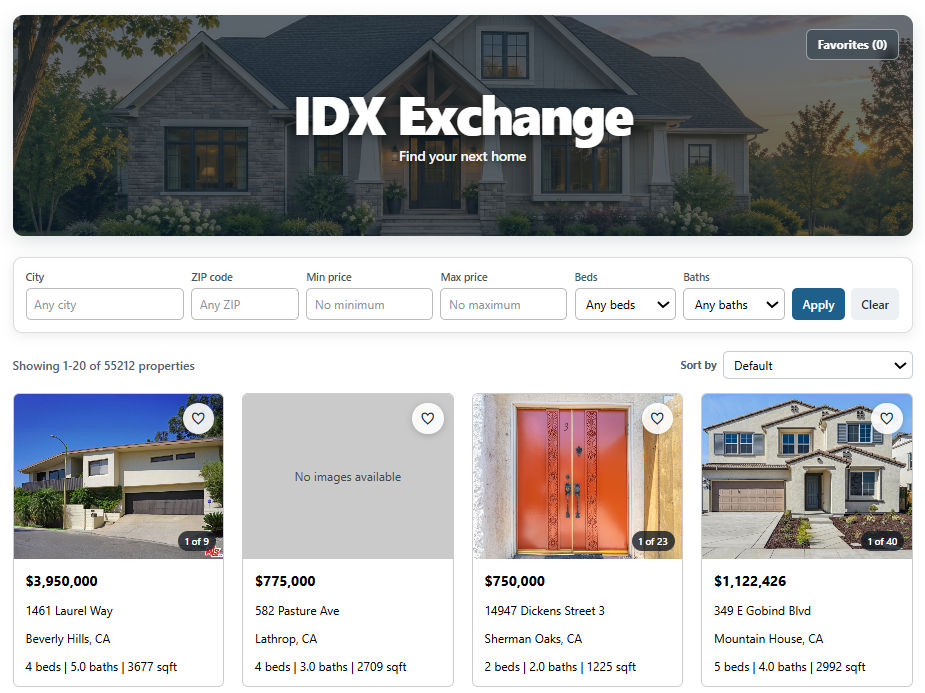

# IDX Exchange

IDX Exchange is a full-stack real-estate search application built with real MLS data. Users can filter, sort, and paginate property listings, inspect full listing details, view photo galleries and maps, review open houses, and save favorites in the browser.

## Screenshot



## Features

- Filter by city, ZIP code, price, bedrooms, and bathrooms
- Sort by price, listing date, and square footage
- Paginate large result sets with compact ellipsis controls
- View listing-card photo carousels and detail-page lightboxes
- Display property details, Google Maps locations, and open houses
- Save favorites in `localStorage` and view them on a dedicated route
- Handle loading, empty, request-error, and React render-error states

## Technology

| Layer | Technology | Version |
| --- | --- | --- |
| Frontend | React | 19.3.1 |
| Frontend routing | React Router DOM | 6.30.1 |
| Frontend build | Create React App / react-scripts | 5.0.1 |
| Runtime validation | PropTypes | 15.8.1 |
| Backend | Node.js and Express | Express 5.2.1 |
| Database client | mysql2 | 3.24.4 |
| Database | MySQL | 8.x |
| Backend testing | Jest and Supertest | Jest 30.5.2, Supertest 7.3.2 |
| Frontend testing | Jest and React Testing Library | RTL 16.3.3 |

## Architecture

```text
Browser
  |
  | http://localhost:3000
  v
React application
  |
  | /api/* through the CRA development proxy
  v
Express API (http://localhost:5000)
  |
  | parameterized SQL through mysql2
  v
MySQL database (rets)
```

Repository layout:

```text
IDX-Exchange-SDE/
|-- api/                    Express route handlers
|-- docs/                   Performance notes and screenshots
|-- frontend/
|   |-- public/             HTML template and public assets
|   `-- src/
|       |-- api/            Browser API client
|       |-- components/     Reusable UI components
|       |-- hooks/          Favorites and photo parsing hooks
|       |-- pages/          Route-level screens
|       `-- utils/          Pure data helpers
|-- test/                   Jest/Supertest backend tests
|-- db.js                   MySQL connection pool
|-- index.js                Express application entry point
`-- package.json            Backend scripts and dependencies
```

## Fresh-Machine Setup

### 1. Install prerequisites

Install:

- Git
- Node.js 20 or newer and npm
- Docker Desktop, or a local MySQL 8 installation
- A Google Maps Embed API key if map display is required

### 2. Clone the repository

```bash
git clone https://github.com/jnnkim1/IDX-Exchange-SDE.git
cd IDX-Exchange-SDE
```

### 3. Install dependencies

Install backend dependencies:

```bash
npm install
```

Install frontend dependencies:

```bash
cd frontend
npm install
cd ..
```

### 4. Prepare MySQL

Start MySQL 8 and create the application database:

```sql
CREATE DATABASE rets;
```

Import the provided property and open-house SQL dumps into `rets`. With the MySQL command-line client, the general form is:

```bash
mysql -u YOUR_USER -p rets < path/to/property-data.sql
mysql -u YOUR_USER -p rets < path/to/open-house-data.sql
```

If MySQL runs in Docker, obtain the container name with `docker ps`, then open the client with:

```bash
docker exec -it YOUR_MYSQL_CONTAINER mysql -u root -p
```

Verify that both tables exist:

```sql
USE rets;
SHOW TABLES;
SELECT COUNT(*) FROM rets_property;
SELECT COUNT(*) FROM rets_openhouse;
```

### 5. Configure backend environment variables

Create `.env` in the repository root:

```env
PORT=5000
MYSQL_HOST=127.0.0.1
MYSQL_PORT=3306
MYSQL_USER=your_mysql_user
MYSQL_PASSWORD=your_mysql_password
MYSQL_DATABASE=rets
```

When Express runs outside Docker and MySQL runs in Docker with port `3306` published, use `127.0.0.1` as the host. Never commit the real `.env` file.

### 6. Configure Google Maps

Create `frontend/.env.local`:

```env
REACT_APP_GOOGLE_MAPS_API_KEY=your_google_maps_embed_api_key
```

Enable the Google Maps Embed API for that key. Restart the frontend server whenever this file changes.

### 7. Start the backend

In the repository root:

```bash
npm run dev
```

The API listens on `http://localhost:5000`. Confirm the database connection at:

```text
http://localhost:5000/api/health
```

### 8. Start the frontend

In a second terminal:

```bash
cd frontend
npm start
```

Open `http://localhost:3000`. Create React App proxies `/api/*` requests to the Express server on port 5000.

## Frontend Routes

| Route | Purpose |
| --- | --- |
| `/` | Search, filter, sort, and paginate property listings |
| `/favorites` | View and remove locally saved favorites |
| `/property/:id` | View one property's details, photos, map, and open houses |

## API Reference

All responses use JSON. Query values are URL encoded by the frontend API client.

### Health check

```http
GET /api/health
```

Successful response:

```json
{
  "status": "ok",
  "database": "connected"
}
```

### List properties

```http
GET /api/properties
```

Supported query parameters:

| Parameter | Description | Default |
| --- | --- | --- |
| `city` | Exact city match | none |
| `zipcode` | Exact ZIP-code match | none |
| `minPrice` | Minimum list price | none |
| `maxPrice` | Maximum list price | none |
| `beds` | Exact bedroom count | none |
| `baths` | Exact bathroom count, including decimals | none |
| `sortBy` | `id`, `L_SystemPrice`, `OriginalEntryTimestamp`, or `LM_Int2_3` | `id` |
| `sortOrder` | `ASC` or `DESC` | `ASC` |
| `limit` | Results per page, from 1 through 100 | `20` |
| `offset` | Number of matching rows to skip | `0` |

Example request:

```http
GET /api/properties?city=Irvine&minPrice=300000&beds=3&sortBy=L_SystemPrice&sortOrder=ASC&limit=20&offset=0
```

Example response:

```json
{
  "total": 42,
  "limit": 20,
  "offset": 0,
  "results": [
    {
      "L_ListingID": "1234567890",
      "L_Address": "1 Test Street",
      "L_City": "Irvine",
      "L_State": "CA",
      "L_Zip": "92620",
      "L_SystemPrice": 500000,
      "L_Keyword2": 3,
      "LM_Dec_3": 2.5,
      "LM_Int2_3": 1800,
      "L_Photos": "[\"https://example.com/property.jpg\"]",
      "OriginalEntryTimestamp": "2026-11-01T12:00:00.000Z"
    }
  ]
}
```

Invalid filters return status `400`:

```json
{
  "status": "error",
  "message": "limit must be an integer between 1 and 100"
}
```

### Get one property

```http
GET /api/properties/:id
```

Example request:

```http
GET /api/properties/1234567890
```

Example response:

```json
{
  "L_ListingID": "1234567890",
  "L_Address": "1 Test Street",
  "L_City": "Irvine",
  "L_State": "CA",
  "L_SystemPrice": 500000,
  "L_Keyword2": 3,
  "LM_Dec_3": 2.5,
  "LM_Int2_3": 1800,
  "YearBuilt": 2005,
  "L_Remarks": "Property description"
}
```

Unknown properties return status `404`:

```json
{
  "status": "error",
  "message": "Property with listing ID 1234567890 was not found"
}
```

### Get property open houses

```http
GET /api/properties/:id/openhouses
```

Example request:

```http
GET /api/properties/1234567890/openhouses
```

Example response:

```json
[
  {
    "id": 1,
    "L_ListingID": "1234567890",
    "OpenHouseDate": "2026-11-30",
    "OH_StartTime": "10:00:00",
    "OH_EndTime": "13:00:00",
    "all_data": "{\"OpenHouseRemarks\":\"Please check in with the host.\"}"
  }
]
```

An existing property with no scheduled events returns an empty array. An unknown property returns status `404`.

## Database Schema Summary

### `rets_property`

Stores one row per property listing. Important columns include:

| Column | Purpose |
| --- | --- |
| `id` | Internal row identifier and stable pagination tie-breaker |
| `L_ListingID` | Public listing identifier used by API routes |
| `L_Address`, `L_City`, `L_State`, `L_Zip` | Property address |
| `L_SystemPrice` | Listing price |
| `L_Keyword2` | Bedroom count |
| `LM_Dec_3` | Bathroom count |
| `LM_Int2_3` | Interior square footage |
| `L_Photos` | JSON-encoded array of photo URLs |
| `OriginalEntryTimestamp` | Listing creation timestamp |
| `LMD_MP_Latitude`, `LMD_MP_Longitude` | Map coordinates |

### `rets_openhouse`

Stores open-house events. Important columns include `id`, `L_ListingID`, `OpenHouseDate`, `OH_StartTime`, `OH_EndTime`, and `all_data`. The `all_data` JSON blob contains supplemental values such as `OpenHouseRemarks`.

### Relationship

`rets_property.L_ListingID` has a one-to-many logical relationship with `rets_openhouse.L_ListingID`: one property may have zero or many open-house rows. The application checks that the property exists before returning its open houses. The supplied schema may not enforce this relationship with a physical foreign-key constraint.

## Testing and Coverage

Run backend Jest/Supertest tests:

```bash
npm test
```

Generate backend coverage:

```bash
npm run test:coverage
```

Run frontend tests once:

```bash
npm --prefix frontend test -- --watchAll=false
```

Generate frontend coverage for the critical components:

```bash
npm --prefix frontend run test:coverage
```

Run lint and create a production build:

```bash
npm --prefix frontend run lint
npm --prefix frontend run build
```

Both coverage commands enforce at least 70% statement and line coverage on their configured critical files.

## Known Issues

- Favorites are stored only in the current browser and are not synchronized between devices.
- Listing and open-house data are imported snapshots rather than a live MLS feed.
- Some source records contain missing, malformed, or unavailable photo URLs.
- Google Maps requires a separately configured API key and may be unavailable when key restrictions are incorrect.
- API request failures are displayed by individual pages; React error boundaries only catch render and lifecycle errors.

## Future Improvements

- Add authenticated user accounts and server-side favorites
- Add saved searches and filter URLs that can be shared
- Add automated browser-level tests for complete search and favorite workflows
- Add image lazy-loading and caching for large result sets
- Add database migrations and automated seed scripts
- Deploy the frontend, API, and database with continuous integration

## Git Workflow

Feature work branches from `develop` and returns through merge commits. Commit messages use Conventional Commit format:

```text
type(scope): short description
```

Example:

```text
test(pagination): cover ellipsis and disabled states
```
